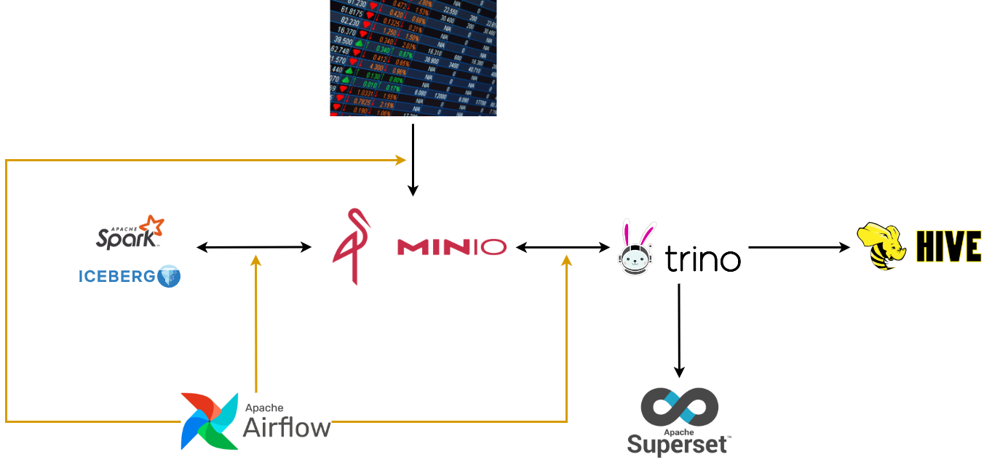
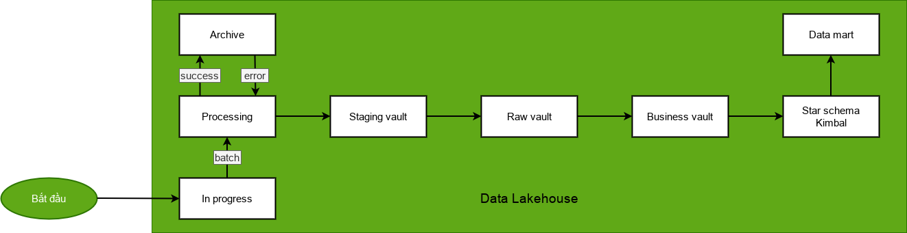

# Process Stock Data — Near Real-time Stock Data Processing System

A near real-time stock data processing system (Viettel Digital Talent 2024 — Data Engineering, Phase 2).  
This project demonstrates an end-to-end data platform with orchestration, lakehouse storage, and BI visualization.

---

## 1) Project Objectives

- Build a **near real-time** stock data processing pipeline
- Build a **data lakehouse** architecture for big data analytics

---

## 2) System Architecture / Data Flow



**High-level flow (conceptual):**
- Data is ingested and processed through the pipeline
- Data is stored in a lakehouse (Iceberg)
- Data is queried via Trino
- Data is visualized in Superset
- Workflows are orchestrated by Airflow

---

## 3) ETL Overview



---

## 4) Tech Stack

- **Docker Compose**: local deployment
- **Apache Airflow**: orchestration / scheduling
- **Apache Iceberg**: lakehouse table format
- **Trino**: query engine
- **Apache Superset**: BI / dashboards
- **Python**: data processing logic

---

## 5) How to Run (Local)

### Prerequisites
- Docker + Docker Compose installed

### Start the system
```sh
docker compose up -d
```

### Start DAGs on Airflow
1. Open Airflow Web UI (check the exposed port in `docker-compose.yml`)
2. Find the project DAG(s)
3. Toggle the DAG **On** and trigger a run if needed

---

## 6) Visualize Data in Superset

In Superset, add a database connection using the SQLAlchemy URI:

```text
trino://hive@trino:8080/iceberg
```

Then:
- Create datasets from the Iceberg catalog
- Build charts and dashboards

---

## 7) Report / Demo

- Slide: `pictures/slide.pptx`
- Video demo: `pictures/demo.mp4`
